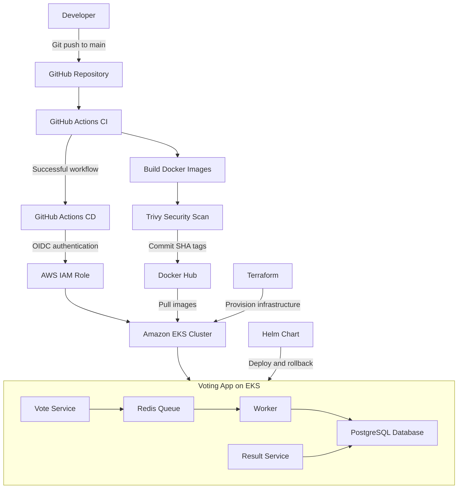
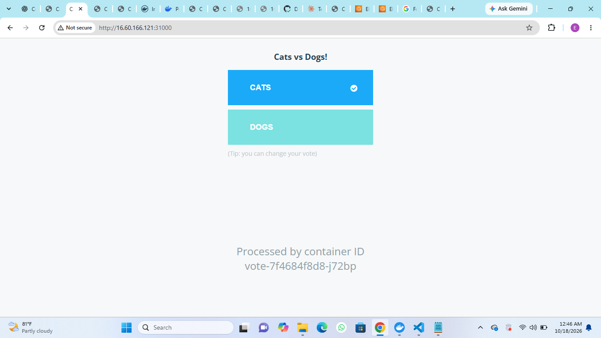
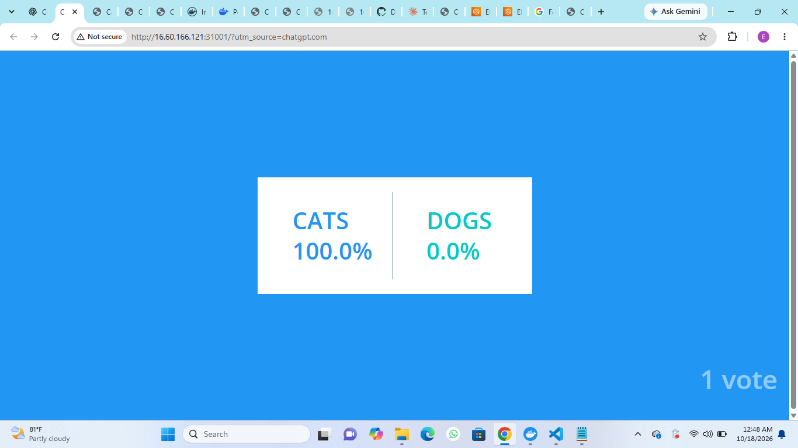
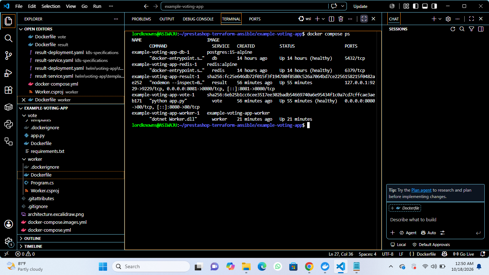
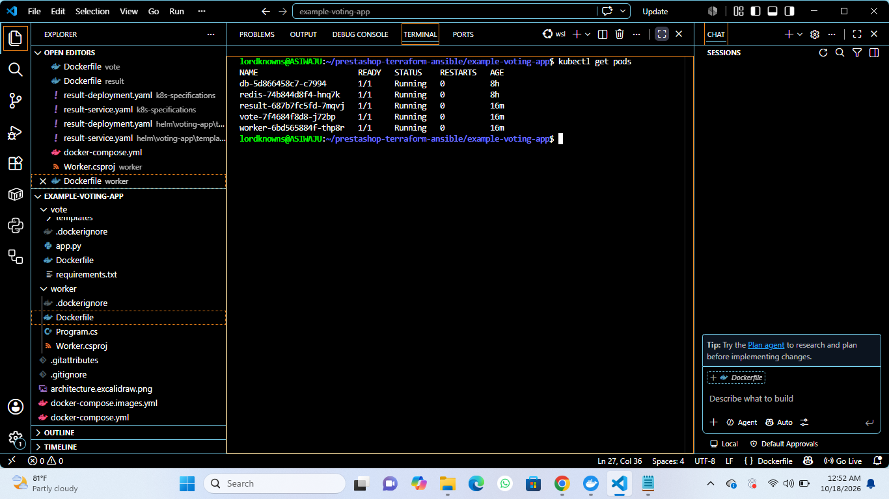
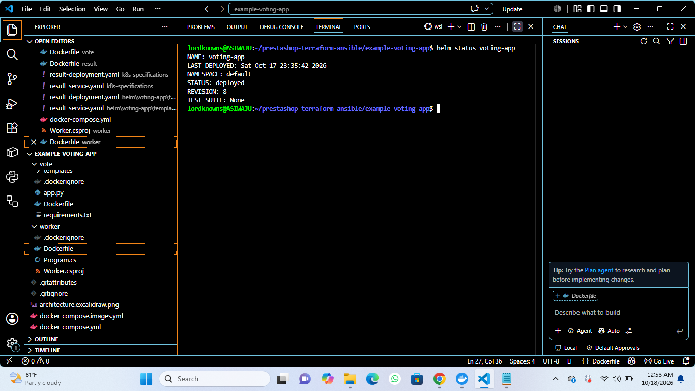
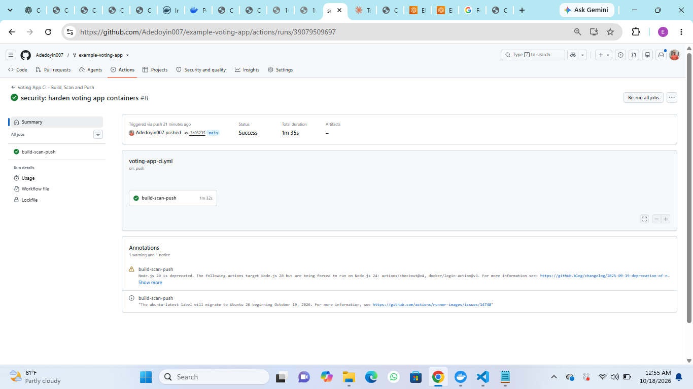
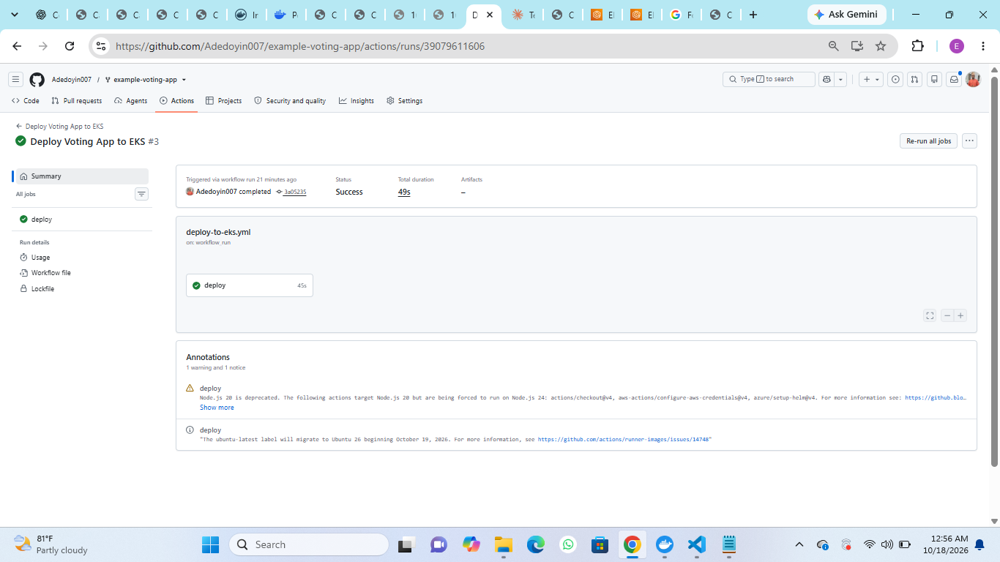
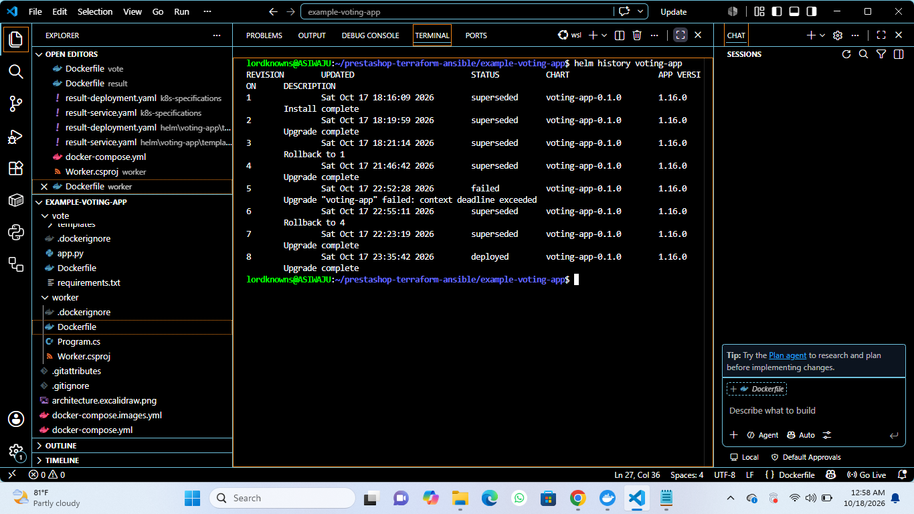

# Voting App — DevOps Capstone

A distributed voting application deployed to Amazon EKS using Terraform, Docker, GitHub Actions, and Helm.

## Architecture



**Flow:** GitHub Actions builds and scans the application images, publishes commit-tagged images to Docker Hub, and deploys them to EKS using Helm. Terraform provisions the infrastructure, and Helm supports releases and rollback.

- **Vote:** Python voting interface.
- **Redis:** Temporary vote queue.
- **Worker:** Processes votes.
- **PostgreSQL:** Stores voting results.
- **Result:** Node.js results interface.

## 1. Run Locally

Requirements: Docker and Docker Compose.

```bash
docker compose up --build
```

- Vote: http://localhost:8080
- Results: http://localhost:8081

Stop with `Ctrl+C`, then run `docker compose down`.

## 2. Provision AWS Infrastructure

Terraform files: `terraform/eks/`

The configuration provisions an Amazon EKS cluster and managed worker nodes in `eu-west-2`, using an existing VPC.

```bash
cd terraform/eks
terraform init
terraform fmt -recursive
terraform validate
terraform plan
terraform apply
```

Configure kubectl:

```bash
aws eks update-kubeconfig --name voting-app-eks --region eu-west-2
kubectl get nodes
```

Review costs before provisioning. Never commit Terraform state or credentials.

## 3. Continuous Integration (CI)

Workflow: `.github/workflows/voting-app-ci.yml`

On pushes to `main`, GitHub Actions:

1. Builds Vote, Result, and Worker Docker images.
2. Scans images with Trivy for HIGH and CRITICAL vulnerabilities.
3. Pushes images to Docker Hub tagged with the commit SHA.

GitHub repository secrets:

- `DOCKERHUB_USERNAME`
- `DOCKERHUB_TOKEN`

The current Trivy scan reports findings but does not fail the pipeline for them.

## 4. Continuous Deployment (CD)

Workflow: `.github/workflows/deploy-to-eks.yml`

After a successful CI run, the workflow authenticates to AWS using GitHub OIDC, configures kubectl, and deploys the Helm chart with commit-SHA image tags.

GitHub repository secret:

- `AWS_ROLE_ARN`

The AWS role trust policy should remain restricted to this repository and the intended branch.

## 5. Helm Deployment and Rollback

Chart: `helm/voting-app/`

```bash
helm status voting-app
helm history voting-app
kubectl get pods
```

Deploy or upgrade:

```bash
helm upgrade --install voting-app ./helm/voting-app \
  --namespace default --wait --timeout 10m
```

A deliberately invalid image tag was deployed to test failure recovery. The failed release was successfully rolled back:

```bash
helm rollback voting-app 4 --wait --timeout 3m
```

## 6. Live Application

- Vote: http://16.60.166.121:31000
- Results: http://16.60.166.121:31001

These addresses depend on the current worker node and may change after infrastructure recreation. Restrict NodePort access to trusted IP addresses.

## 7. Cleanup

When screenshots and evidence are saved, remove the Terraform-managed infrastructure to avoid ongoing AWS charges:

```bash
cd terraform/eks
terraform destroy
```

Review the plan before confirming. This takes the application offline.

## Security

- Never commit Terraform state, private keys, credentials, or `.env` files.
- Use GitHub secrets for credentials and OIDC for AWS deployment.
- Review Trivy findings and update vulnerable images and dependencies.
- Restrict public access to Kubernetes NodePorts.

## Original Project

Based on the [Docker Samples Example Voting App](https://github.com/dockersamples/example-voting-app).
## Architecture Diagram

The following diagram shows the CI/CD workflow and the application components deployed to Amazon EKS.


The editable Mermaid architecture diagram is documented in the Architecture section above.

## Project Evidence

### 1. Voting Application





### 2. Local Docker Compose



### 3. Amazon EKS Deployment





### 4. CI/CD Pipeline





### 5. Helm Rollback Test


